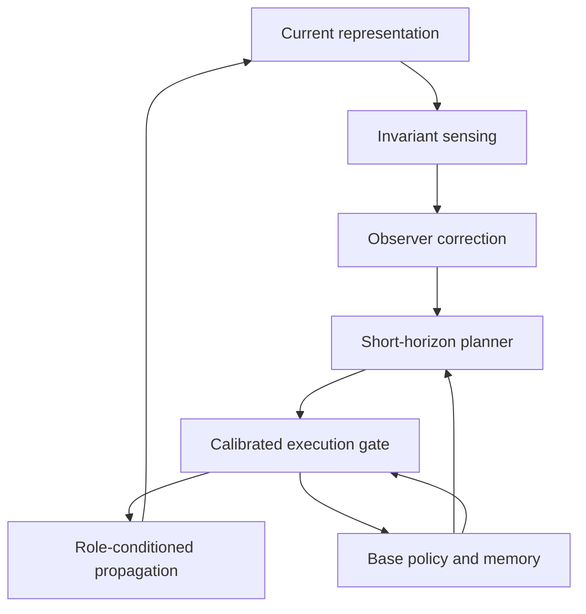

# ROPC

**Role-conditioned Operator Predictive Control for deep graph neural networks.**

This repository implements the software pipeline described in *Predicting Before
Propagating: Role-Conditioned Operator Predictive Control for Deep Graph Neural
Networks* and its supplementary material. It includes the constrained graph
propagation model, role-conditioned operator bank, predictive controller,
interventional identification, planner–amortizer training, calibration, audit,
evaluation, and Arrhenius job submission.

The **24 primary dataset configurations** from supplementary Table IX each have
their own experiment directory, configuration, Python entry point, and shell
entry point. They share one implementation of the scientific method.

## Quick start

Use Python 3.10 or newer. Install the PyTorch build appropriate for your machine
first. For a local CPU environment:

```bash
python3 -m venv .venv
source .venv/bin/activate
python -m pip install --upgrade pip
python -m pip install torch --index-url https://download.pytorch.org/whl/cpu
python -m pip install -e '.[datasets,dev]'
python -m ropc list
python -m ropc validate --device cpu
python -m unittest discover -s tests -v
```

Run a small, explicitly synthetic integration experiment:

```bash
python -m ropc run \
  --dataset ogbn-arxiv --preset smoke --synthetic \
  --device cpu --threads 2 --output runs/arxiv-smoke
```

Synthetic fixtures validate execution and task interfaces. Their outputs are
marked `synthetic: true` and are not benchmark results. `--preset smoke` reduces
the computational budget; `--synthetic` is the separate, explicit data choice.
A failed official download never substitutes synthetic data.

## Run an official dataset

```bash
python -m ropc prepare --dataset ogbn-arxiv --data-root data
python experiments/ogbn-arxiv/run.py \
  --preset pilot --data-root data --device cuda \
  --seeds 0 --output runs/ogbn-arxiv-pilot
```

For a primary-budget experiment, use `--preset full`. Ten seeds can be selected
with `--seeds 0,1,2,3,4,5,6,7,8,9`. The full preset preserves the paper's long
training and continuation budgets and requires substantially more computation
than the smoke test. `pilot` is a development budget, not the primary protocol.

The independent entry points work identically across datasets:

```bash
python experiments/peptides-func/run.py \
  --preset pilot --device cuda --data-root data \
  --output runs/peptides-func-pilot

python experiments/lrim-32/run.py \
  --preset full --device cuda --data-root data \
  --output runs/lrim-32-full
```

Override configuration fields with a JSON file using `--config`. Unknown fields
and mismatched dataset names are rejected. The resolved configuration, input
fingerprint, code identity, seeds, and environment are recorded with the run.

For Roman-empire, Amazon-ratings, and Minesweeper, `--split-index` chooses one of
the ten official split columns. Run each column separately for the paper's
split-paired protocol; multiple seeds on column zero do not constitute ten
official splits.

## Arrhenius

The supplied cluster settings are retained in the launcher:

| Setting | Value |
|---|---|
| Account | `naiss2025-5-643-gpu` |
| Partition | `gpu` |
| Storage project | `naiss2025-6-428` |
| Project directory | `/nobackup/proj/disk/naiss2025-6-428/from-alvis/tnnls` |
| Environment | `code/venv_arrhenius_gh200` under the project directory |
| Build module | `GPU/buildenv-nvhpc/25.9-cu13.0` |
| Python module | `GPU/Python/3.13.5-bare-gcc-2025b-eb` |

Preview the exact submission without contacting Slurm:

```bash
bash experiments/ogbn-arxiv/run.sh dry-run
```

Initialize the directories and submit an experiment on the cluster:

```bash
bash experiments/ogbn-arxiv/run.sh init
sbatch --array=0-2%2 experiments/ogbn-arxiv/run.sh pilot
sbatch --array=0-9%2 experiments/lrim-32/run.sh full
```

The launcher isolates datasets, suites, seeds, caches, and logs, and copies the
source for each submitted suite. Settings containing commas are exported through
the inherited environment. See [the Arrhenius guide](docs/ARRHENIUS.md) for
environment checks, resource overrides, resume commands, and output locations.

## Training and evaluation stages

| Stage | Result |
|---|---|
| `warmup` | Warm-up model and configured intermediate checkpoints |
| `bank` | Table IX bank selection record, or an explicitly requested bank search |
| `openloop` | Reference and free-spline backbones; frozen observation/loss scales |
| `rounds` | Branch data, fitted transition/value models, planner improvement, DAgger students |
| `refit` | Final observer, value heads, student, and backbone used for deployment |
| `calibrate` | Reliability scorer and execution envelope fitted on tuning samples |
| `audit` | Frozen-policy audit and, when required, reserve-set fallback audit |
| `evaluate` | Task metrics, depth sweeps, controller diagnostics, regret and timing records |
| `reduce` | Aggregate results across the selected seeds and write a readable report |

The controller observes the current representation, corrects its compact state
estimate, and plans a short action sequence. The execution gate blends the first
proposal with the base action according to its calibrated predicted advantage.
The propagation model executes that action, and the observer and base memory
advance using the action actually executed.



An audit can finish successfully as a computation and still report
`policy_pass: false`. Empty bins, inadequate calibration support, and insufficient
audit evidence are not converted into a passing claim. Single-graph perturbation
audits are empirical diagnostics; they do not establish an independent-graph
coverage guarantee. See [method and audit details](docs/METHOD.md).

## Dataset organization

| Group | Independent experiment directories |
|---|---|
| Single graphs | [ogbn-arxiv](experiments/ogbn-arxiv), [ogbn-products](experiments/ogbn-products), [ogbn-proteins](experiments/ogbn-proteins), [Roman-empire](experiments/roman-empire), [Amazon-ratings](experiments/amazon-ratings), [Minesweeper](experiments/minesweeper) |
| Development families | [PascalVOC-SP](experiments/pascalvoc-sp), [COCO-SP](experiments/coco-sp), [Peptides-func](experiments/peptides-func), [Peptides-struct](experiments/peptides-struct), [PATTERN](experiments/pattern), [CLUSTER](experiments/cluster) |
| LRIM hard setting | [LRIM-16](experiments/lrim-16), [LRIM-32](experiments/lrim-32), [LRIM-64](experiments/lrim-64), [LRIM-128](experiments/lrim-128) |
| Additional families | [CIFAR10](experiments/cifar10), [ZINC](experiments/zinc), [MNIST](experiments/mnist), [MalNet-Tiny](experiments/malnet-tiny), [ogbg-molhiv](experiments/ogbg-molhiv), [PCQM-Contact](experiments/pcqm-contact), [ogbg-molpcba](experiments/ogbg-molpcba), [ogbg-ppa](experiments/ogbg-ppa) |

Each directory contains `config.json`, `run.py`, `run.sh`, and its dataset guide.
Official datasets are downloaded into separate cache directories and are excluded
from Git. [Dataset details](docs/DATASETS.md) describe the task schemas, metrics,
input preprocessing, fixed graph partitions, and large-graph training batches.

The separate [P5 LRIM size-transfer protocol](protocols/lrim-size-transfer/README.md)
trains LRIM-16 with a ceiling of 64 and evaluates its frozen policy on sides
32, 64, 128 and 256 at depths 64, 128, 256 and 512. Use `python -m ropc transfer`
with its verified source run. Target evaluation preserves the source weights,
normalizer and calibration; source audit qualification is recorded separately
from the unaudited target-size population.

## Resume and inspect results

Resume with the same configuration and output directory:

```bash
python -m ropc run \
  --dataset ogbn-arxiv --preset smoke --synthetic --device cpu \
  --output runs/arxiv-smoke --resume
```

Completed stages are reused only after checking their run identity and artifact
hashes. A different dataset, configuration, code version, seed list, or changed
checkpoint requires a new output directory. A partially finished task reruns
from its stage/checkpoint boundary; the implementation does not claim exact
mid-optimizer-step recovery.

Key files under an experiment output are:

| Path | Contents |
|---|---|
| `run_spec.json` | Resolved scientific configuration and data/code identities |
| `environment.json` | Runtime versions, device and Slurm metadata |
| `000_MANIFEST/` | Configuration and ordered task lists |
| `ARTIFACTS/seed*/` | Backbones, controller states, calibration and audit records |
| Numbered stage directories | Per-task completion, failure and result records |
| `900_REDUCE/REPORT.md` | Aggregate measured results |
| `status.json` | Complete/partial execution status |

## Repository guide

| Location | Responsibility |
|---|---|
| `ropc/model.py` | Graph model, roles, kernels, constrained actions and sensing |
| `ropc/control.py` | Observer, planner, convex heads, reliability and execution |
| `ropc/training.py` | Task training, branch collection, identification and DAgger |
| `ropc/evaluation.py` | Calibration, audit, metrics and controller diagnostics |
| `ropc/datasets.py`, `ropc/tasks.py` | Official inputs, graph partitions, readouts, losses and metrics |
| `ropc/registry.py` | All Table IX dataset configurations |
| `ropc/runner.py`, `ropc/cli.py` | Resumable stages and command-line interface |
| `ropc/transfer.py`, `protocols/` | Frozen-policy LRIM size-transfer evaluation |
| `experiments/` | Separate dataset entry points and configurations |
| `scripts/` | Cluster launcher and suite-management utilities |
| `tests/` | Numerical, data-isolation and integration regression tests |
| `docs/` | Method mapping, dataset contracts, cluster use and validation scope |

Read [verification](docs/VERIFICATION.md) before interpreting runtime checks as
experimental evidence. The repository does not contain trained checkpoints or
invented benchmark scores. Full-budget GPU training, all published comparison
arms, and statistical reproduction of the paper's tables are separate
experiments. Implementation choices that cannot be inferred uniquely from the
manuscript are explicit in the method and dataset guides.

## Citation and ownership

See [CITATION.bib](CITATION.bib) for the manuscript and benchmark references, and
[NOTICE.md](NOTICE.md) for source ownership and dataset licensing information.
